# Range Trainer ♠️

Treinador de poker que roda direto no navegador, feito para estudar **ranges de abertura pré-flop**, **leitura de showdown** e **texturas de board**, sem precisar pagar por nada.

<p align="center">
  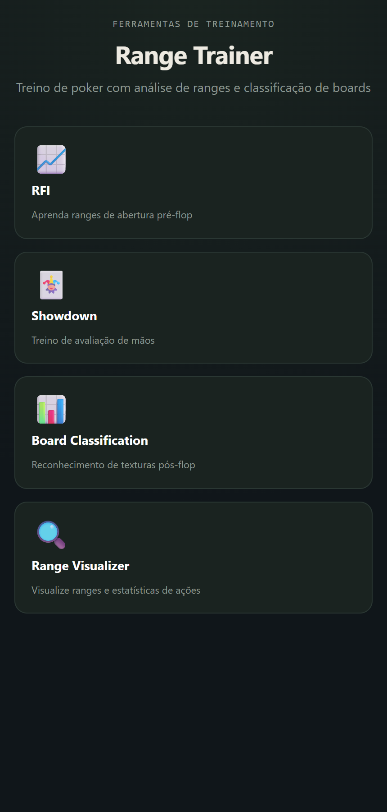
</p>

---

## Por que esse projeto existe

As ferramentas de treino de poker mais conhecidas (trainers de GTO, solvers, apps de range) são **caras** e quase sempre cobradas por assinatura mensal. Este projeto nasceu justamente para **não ter que pagar por esses sistemas**.

Na época eu queria **virar jogador profissional** e precisava treinar uma coisa muito específica, todo dia: *"com essa mão, nessa posição, eu abro ou não abro?"*. Eu ficava testando meu conhecimento mão por mão, posição por posição, até as decisões de abertura ficarem automáticas. Daí saiu o modo **RFI**.

Ao mesmo tempo, eu queria um **emprego de meio período como dealer de poker**. Na mesa, o dealer precisa olhar o board e as mãos e dizer **quem ganhou em poucos segundos**, sem errar e sem travar o jogo. Para treinar essa leitura rápida, criei o modo **Showdown**, que mede o tempo de cada resposta.

---

## O que a aplicação faz

### 📈 RFI: ranges de abertura pré-flop

Você escolhe a modalidade, os níveis de stack (de 8bb a 100bb) e as posições que quer treinar. A aplicação sorteia uma mão numa posição da mesa e você decide: **Fold, Call, Raise ou All-in**.

<p align="center">
  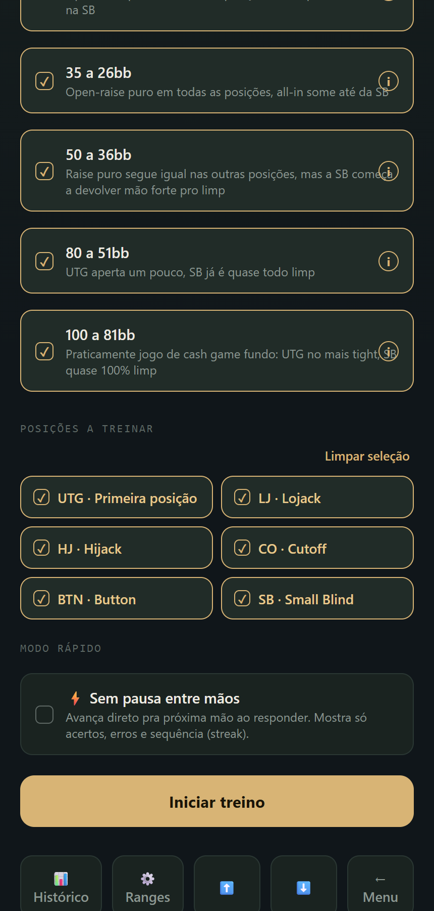
  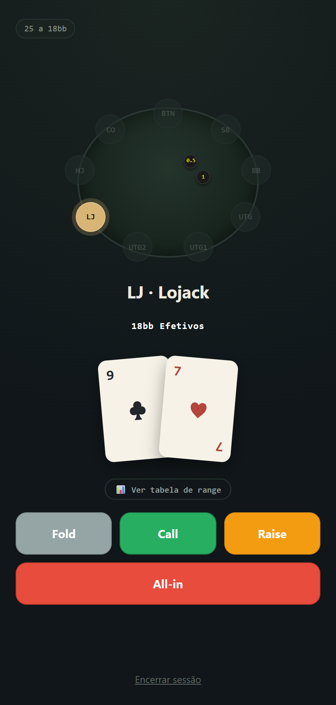
  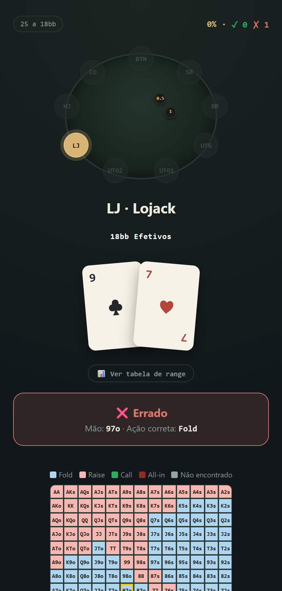
</p>

- Depois de cada resposta, mostra se você acertou, qual era a ação correta e a **tabela de range completa** com a sua mão destacada.
- Usa **repetição espaçada (FSRS)**: as mãos que você erra voltam com mais frequência, e as que você já domina aparecem menos.
- **Modo rápido** ("sem pausa entre mãos"), para fazer volume.
- **Ranges editáveis:** dá para importar os seus próprios ranges em JSON ou voltar para o padrão.
- **Importar/exportar** o progresso do FSRS, para levar o estudo para outro dispositivo.

O **histórico** mostra a taxa de acerto geral, por posição e por nível de blind, além de um gráfico de progresso diário:

<p align="center">
  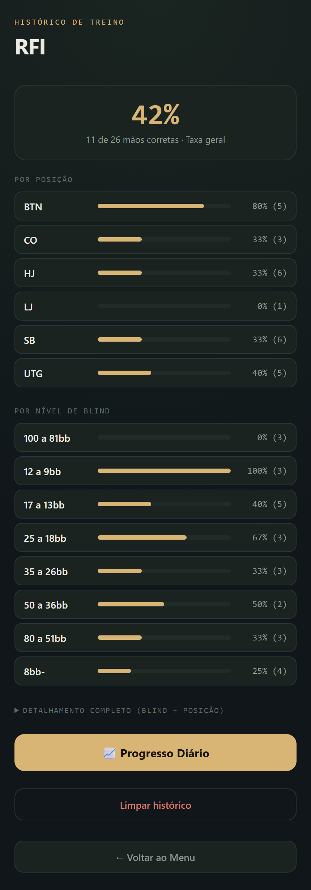
</p>

### 🃏 Showdown: quem ganhou a mão?

Feito para treinar a leitura de showdown na velocidade de um dealer. O board é revelado, as mãos de 2 a N jogadores aparecem e você aponta o vencedor. **O cronômetro conta** o seu tempo de resposta.

<p align="center">
  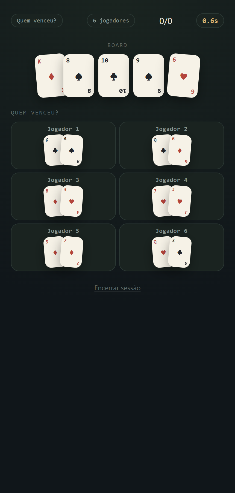
  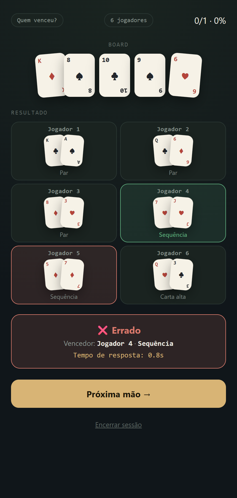
  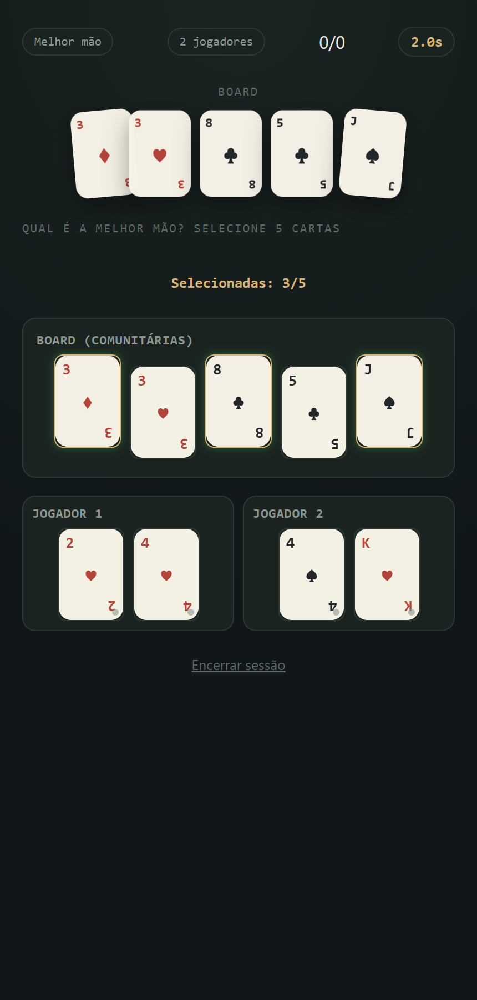
</p>

- **Quem venceu?**: escolha qual jogador leva o pote. Na correção aparece a mão de cada um (par, sequência, flush etc.) e o seu tempo de resposta.
- **Melhor mão**: selecione as 5 cartas que formam a melhor mão entre as 7 disponíveis. É o que o dealer precisa enxergar para "ler" a mão em voz alta.
- Você define o número de jogadores na mesa; quanto mais jogadores, mais difícil.

### 📊 Board Classification: textura do flop

Treina o reconhecimento das texturas pós-flop. Para cada flop sorteado, você classifica **conectividade**, **altura** e **naipes** (rainbow, duo-tone, monotone).

<p align="center">
  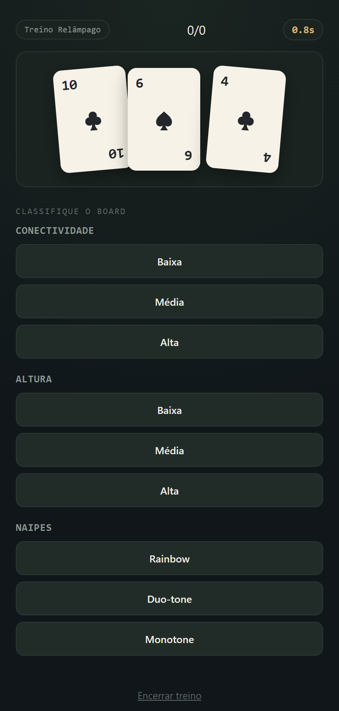
  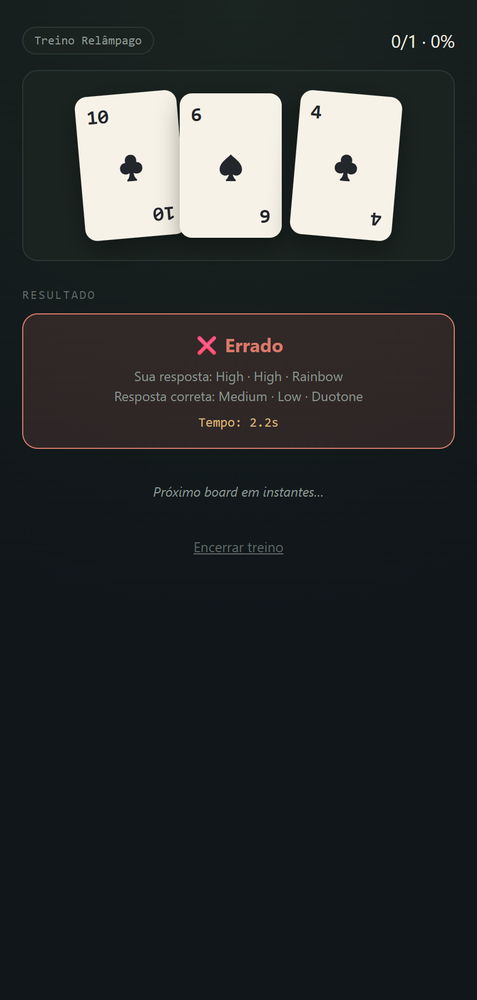
</p>

Há dois modos: **Treino Relâmpago**, para classificar rápido e com tempo, e **Estudo Detalhado**, com a análise completa de cada board.

### 🔍 Range Visualizer

Mostra qualquer range na grade 13×13 com a contagem e a porcentagem de cada ação (all-in, raise, call, fold). Cobre os cenários *open range*, *vs open raise*, *vs 3-bet* e *vs open shove*, e também tem um modo para **comparar dois ranges lado a lado**.

<p align="center">
  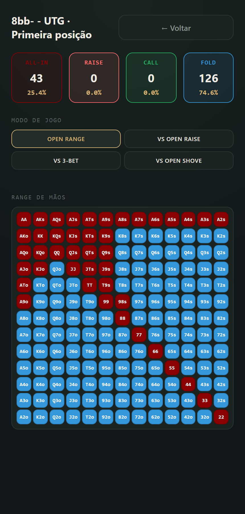
</p>

---

## Como rodar

O projeto é só HTML, CSS e JavaScript puro, sem build e sem dependências. Basta servir a pasta com qualquer servidor estático:

```bash
python -m http.server 8000
```

Depois é só abrir <http://localhost:8000>.

O progresso fica salvo no `localStorage` do navegador. A interface foi pensada para o celular, para treinar em qualquer lugar.

## Estrutura

```
index.html                     menu principal
treino_open_raise.html         RFI
treino_showdown.html           Showdown
treino_boards.html             Board Classification
treino_range_visualizer.html   Range Visualizer
js/                            lógica de cada modo, avaliador de mãos, FSRS e storage
css/                           estilos
data/ranges_default.js         ranges padrão
```
